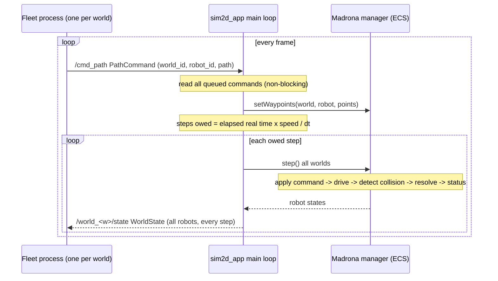

# Communication layer

Transport is ZeroMQ. Every message is two frames: a topic string, then a
protobuf body (definitions in `proto/sim2d_msgs.proto`).

| Topic | Message | Direction | Socket |
|---|---|---|---|
| `/world_<w>/state` | `WorldState` | sim -> clients | sim PUB binds `tcp://*:5555` |
| `/cmd_path` | `PathCommand` | clients -> sim | sim SUB binds `tcp://*:5556` |

Clients connect (PUB for commands, SUB for state). Many clients can connect to
the same ports. Subscribe with the full topic, e.g. `/world_1/state`, so that
`/world_1/state` does not also match `/world_10/state`.

## Sequence

When it publishes: once per simulation step, one `WorldState` per world, so at
`1/dt` Hz of simulated time (25 Hz for dt = 0.04) at 1x speed. The header has
`seq` (step counter) and `stamp_ms` (simulated time). Pausing stops state
messages.

How to command a robot: publish a `PathCommand` on `/cmd_path`. A command takes
effect on the next step and clears the robot's stopped / collided flags. An
empty path clears the path. A path longer than `SIM2D_MAX_WAYPOINTS` is ignored
with a message on the sim's stderr. `tools/publish_waypoints.py` is a working
example.

How to tell a robot is done: in `RobotState`, `finished` is true when it has
reached its last waypoint; `stopped` and `hit_robot` tell you why it halted.

## Adding a new message type

1. Add the `message` to `proto/sim2d_msgs.proto`. Use `repeated` or strings
   only if needed; for those add a line in `proto/sim2d_msgs.options`
   (repeated fields use `type:FT_CALLBACK`, strings need `max_size:<n>`).
2. Run `NANOPB_GEN=/path/to/nanopb_generator.py tools/gen_msgs.sh`. This
   regenerates `gen/sim2d_msgs.pb.c/.h` (simulator) and
   `tools/sim2d_msgs_pb2.py` (Python).
3. Pick a topic name (for example `/world_<w>/events`).
4. Simulator side (`src/app.cpp`):
   - to publish: fill the generated struct, encode with `pb_encode`, send the
     topic frame then the body (copy `publishWorldState`);
   - to receive: add `zmq_setsockopt(sub, ZMQ_SUBSCRIBE, "<topic>", ...)`,
     decode with `pb_decode` (copy `pollPathCommand`), and act on it in the
     main loop.
5. Python side: import it from `sim2d_msgs_pb2`, send
   `[topic, msg.SerializeToString()]` or parse the body you receive.

Adding a field to an existing message is safe: use the next unused field number
and never reuse or renumber old ones.
